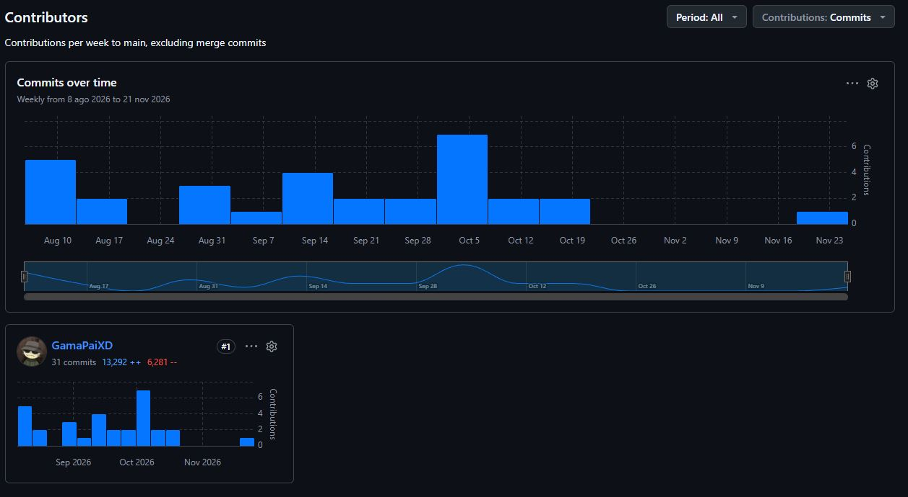

# Curso de Métodos Estadísticos
## Licenciatura en Ingeniería Forestal

Curso correspondiente al semestre **Agosto – Diciembre 2026**.

Este repositorio contiene los códigos, ejercicios, tareas, prácticas de laboratorio y evaluaciones desarrollados durante el curso de Métodos Estadísticos, utilizando principalmente el lenguaje de programación R.

## :footprints: Primeros pasos

**Semana 2: Inicio del curso**

- Preparé mi área de trabajo.
- Creé mi cuenta de GitHub: `GamaPaiXD`.
- Creé mi primer repositorio.
- Modifiqué el archivo `README.md`.
- Descargué e instalé Git.
- Cloné mi repositorio de GitHub en RStudio.
- Configuré las credenciales de GitHub para sincronizar el repositorio.
- Realicé mi primera sincronización exitosa :heavy_check_mark:
- Se presentó un error relacionado con los servidores internos al intentar subir archivos a la nube :heavy_exclamation_mark:
- Solucioné el problema y conseguí sincronizar correctamente el repositorio :heavy_check_mark:

## :dart: Objetivo del repositorio

Organizar y documentar las actividades realizadas durante el curso de Métodos Estadísticos, recopilando los códigos desarrollados en R y los documentos correspondientes a tareas, laboratorios y evaluaciones.

## :books: Utilidad del repositorio

Este espacio permite conservar un registro de las actividades realizadas durante el semestre, consultar los procedimientos estadísticos aplicados y dar seguimiento a los avances en el aprendizaje y manejo del lenguaje R.

## :file_folder: Organización del repositorio

| Carpeta | Contenido |
|---|---|
| `Scripts` | Códigos y ejercicios desarrollados en R. |
| `Tareas` | Documentos correspondientes a las tareas del curso. |
| `Laboratorios` | Prácticas y actividades de laboratorio. |
| `Evaluaciones` | Exámenes y ejercicios de evaluación. |
| `Ejercicios` | Ejercicios complementarios realizados durante el curso. |
| `Resultados` | Archivos HTML y resultados generados mediante R. |

## :calendar: Actividades del curso

Las actividades se presentan siguiendo el orden cronológico de su realización:

1. **Primeros pasos con R y GitHub:** configuración del entorno de trabajo y creación del repositorio.
2. **Prácticas de laboratorio:** desarrollo de ejercicios y análisis de datos relacionados con fertilizantes.
3. **Ejercicios de correlación:** aplicación de métodos estadísticos para analizar relaciones entre variables.
4. **Tarea de correlación:** resolución de ejercicios utilizando R.
5. **Regresión lineal:** aplicación de modelos de regresión y análisis de relaciones entre variables.
6. **Asignación 6:** desarrollo de ejercicios de regresión lineal.
7. **Evaluación parcial:** aplicación de los conocimientos adquiridos durante el curso.
8. **Segunda evaluación:** resolución de ejercicios y procedimientos estadísticos.
9. **Prueba de hipótesis:** aplicación de procedimientos de inferencia estadística.

*Nota: las actividades descritas corresponden a los materiales recopilados hasta el momento y pueden no representar la totalidad de los trabajos realizados durante el semestre.*

## :computer: Herramientas utilizadas

- **R:** lenguaje de programación para el análisis estadístico.
- **RStudio:** entorno de desarrollo para trabajar con R.
- **Git:** sistema de control de versiones.
- **GitHub:** plataforma para almacenar y documentar el repositorio.

## :memo: Registro de avances

Los cambios realizados en el repositorio se documentan mediante commits, utilizando mensajes descriptivos que permiten identificar las modificaciones y avances realizados durante el curso.
## :bar_chart: Evidencia de contribuciones

La siguiente gráfica muestra el registro de contribuciones realizadas durante el desarrollo de este repositorio.

